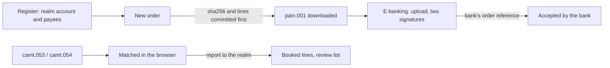

# Banking extension: how it works

The details behind [README.md](README.md): the flow, what the realm keeps, the formats and their rules, why the screen
runs in the realm's page, the tests, and the limits.

Pay, collect and be paid through the realm's ordinary bank account, with no bank connector. The realm writes the
payment or direct debit file, the treasurer uploads and approves it in the realm's own e-banking, and brings the bank's
status reports and statements back. No bLink, no EBICS, no operator service: nothing here talks to a bank.

1. **Register.** The realm's own account and each payee's bank details (IBAN, name at the bank, postal address),
   kept as one encrypted record of the treasury department.
2. **Order.** The treasurer picks payees and amounts. The file is generated in the browser, deterministically, and
   its sha256 and every line (id, amount, currency, payment group, payee id) are recorded in the realm **before** the
   file is handed out. Each payment's `EndToEndId` is its realm id (`BK-20261124-0001-03`).
3. **Check before signing.** The second signatory opens the order and compares the per-person list, read from the
   committed file itself, with the e-banking screen. At a bank that books a salary group as one entry this list is
   the only per-person check: PostFinance's EPO manual (Sep 2024, §4.2.9) says salary orders ignore `BtchBookg` and
   are always batch-booked, so the per-person lines never reach `camt.053`.
4. **Accepted.** The bank's `pain.002` status report, imported, marks the order accepted or rejected (with the
   bank's reasons, and the payments it rejected on the review list). Without one, the bank's order reference can be
   entered by hand once the order is signed in the e-banking.
5. **Statements.** A `camt.052`, `camt.053` or `camt.054` is read and matched in the browser: payments and collections
   by `EndToEndId` (or by their payment group when the bank books the group as one entry), returns by `EndToEndId` in
   the other direction, incoming payments by the invoice's QR or RF reference. Entries not booked yet (an intraday
   `camt.052` has them) go on the review list. The file is kept encrypted with its matches, each statement is reported
   to the realm, and whatever did not match is listed for review.

**Collections.** The same flow collects by direct debit (`pain.008`): the register keeps the realm's SEPA creditor
identifier (or PostFinance RS-PID) and each payer's mandate, an order is a collection from payers instead of payments
to payees, and the statements bring each collection back as collected, booked as a group, or returned.

## What the realm keeps, and who sees it

Nothing in the realm changes for this extension: it uses GGG's Document, External and Dispatch as they are.

| Record | How | In clear | Encrypted |
|---|---|---|---|
| Bank register | Document `banking.register` of the treasury department | title only | accounts, payees |
| Payment order | Document `banking.order`; a dispatch to the outside body `bank` (channel `manual`) | sha256, per line: id, amount, currency, group, payee id | the file |
| Statement import | Document `banking.statement`; `external_report` per statement | ids, amounts, dates, counts | the file, the matches with names |

**Per-person amounts stay in clear**, as transfers are today; bank details and the statement files do not. The keys
are the realm's live scheme (vetKD, a per-record key wrapped per principal: realms-gos `lib/crypto/sharing.ts`), wrapped
for the department's head and seat holders at the time of saving. Someone seated later reads a record once a colleague
saves it again.

**Permission.** The treasury department is the one where the user holds a seat and the treasury permission. The realm
enforces the rest: `document_store`, `document_list` and the document's key are for that department's staff only
(realms-gos `api/crypto.py`, `staff()`), whatever other permission a caller holds. Sending the order to the bank's
outbox, confirming it and reporting a statement also need `notification.send`, `dispatch.confirm` and `external.report`,
which the realm's codex must give the treasury's seats.

## Formats

The format layer is `frontend-rt/src/lib/formats.ts`: each format is its checks, its grouping and its writer, so a new
one (generic ISO 20022 CGI-MP, a national fixed-width format) is one more entry.

- **Swiss Payment Standards 2025**: `pain.001.001.09`, SIX's XSD `pain.001.001.09.ch.03.xsd`, IG v2.2. Payment types
  D (domestic CHF/EUR, QR-bill with a QR-IBAN and QR reference), S (SEPA) and X (foreign currency, abroad: needs the
  payee bank's BIC); one payment group per type, currency and salary flag; salaries carry `CtgyPurp/Cd SALA` at the
  group level; `BtchBookg` true; the debtor bank by its IID when no BIC is given; the software in `InitgPty/CtctDtls`
  (IG 3.9); the SPS character set (IG 3.1) checked, not converted.
- **SEPA Credit Transfer** (EPC132-08, 2025 v1.0): `pain.001.001.09`. The EPC's own XSD could not be downloaded by a
  script (the EPC site sits behind a bot check), so the file is validated against ISO's `pain.001.001.09.xsd` and the
  EPC rules are enforced in code (`lib/sepa.ts`). That is a weaker guarantee: a reviewer cannot re-run a schema to
  check them. The rules implemented: EUR only; debtor and payee IBANs in SEPA countries; amount at most 999,999,999.99;
  service level `SEPA` and charges `SLEV` on every group; a creditor reference or a note, not both; no QR reference;
  names, towns and notes converted to the EPC's basic Latin set (accents dropped, `&` as `+`), and shown converted on
  the review screen; `NOTPROVIDED` as the debtor bank when no BIC is given.
- **SEPA Direct Debit Core** (EPC130-08, 2025): `pain.008.001.08`, validated against ISO's schema; the EPC rules in
  `lib/sdd.ts`: EUR only, SEPA IBANs, a valid creditor identifier (EPC262-08 check digits), each collection's mandate id
  and date of signature (on or before the collection), service level `SEPA`, local instrument `CORE`, one group per
  sequence type, charges `SLEV`, an RF reference or a note.
- **PostFinance CH-DD**: `pain.008.001.02.ch.03`, SIX's Swiss direct debit schema (SPS 2018, IG v1.2), validated against
  it: both accounts at PostFinance, the creditor's RS-PID (ISO 7064 MOD 97-10), codes `CHDD` / `DDCOR1`, unstructured
  remittance only. The mandates are PostFinance's. The other Swiss procedures are left out on purpose: SIX's LSV+ and
  BDD take no new creditors since 1 January 2026 and end on 30 September 2028, and eBill Direct Debit runs through
  eBill rather than a file.
- **Statements**: `camt.052`, `camt.053` and `camt.054`, read by element name, so versions 001.04 to 001.08 work.
- **Status reports**: `pain.002` (SPS: `pain.002.001.10`), read the same way.
- **Addresses**: every account in the register needs a structured address with at least a town and a country, which
  SPS and the EPC require since November 2026.

## Behind its own backend, in a sandboxed frame

The screen runs in a sandboxed iframe (`runtime: sandboxed`) and reaches the realm only through Banking's backend,
`backend/entry.py`, which the realm runs as the member, in its own sandbox, with only the operations the manifest
declares. The reads are those operations by their names. The writes are Banking's own functions, so that what the realm
records holds together whatever the screen does:

| Function | What it does in one call |
|---|---|
| `commit_order` | stores the sealed order with its facts, then sends the dispatch to the bank naming the document and the file's sha256, taken from the order's own facts |
| `download_allowed` | answers the realm's page before a file leaves the frame: yes only once a dispatch to the bank names the file's sha256 |
| `save_register` | stores the register, of that kind only, sealed |
| `import_statement` | stores a bank file, of that kind only, then reports each statement in it |
| `dispatch_confirm`, `register_bank` | the bank's answer to an order; the bank as an outside body |

A function that fails after it changed the realm traps, and the realm undoes the whole call: an order is never stored
without its commitment, nor committed without its record.

The frame holds no key and may not start a download. The realm's page does both for it, through the bridge's
capabilities (realms-gos `cto/sandbox-vault-download`):

- `vault`: the page seals a record for the treasury's staff, or opens one with the key wrapped for the member, with the
  member's vetKey, which never enters the frame (`lib/vault.ts`);
- `download`: the page hashes the file, asks the backend `download_allowed`, and saves it only on yes. So a file whose
  hash the realm has not recorded cannot leave, whatever the frame does (the walk checks a forged one is refused).

What crosses the bridge is a JSON copy (`plain` in `lib/vault.ts`): `postMessage` cannot copy the screen's reactive
state. The same `vault` capability is what members entering their own bank details from member_dashboard would need.

## Tests

- `run_tests.sh`: the backend's tests (`tests/test_backend.py`, on a stand-in for the realm's `rpc`), the unit tests (`frontend-rt/src/lib/*.test.ts`: formats, references, camt matching, the encryption
  round trip and permission refusal on an in-memory realm), the build, and `tests/xsd/check.sh`, which validates the
  sample files against the pinned SIX and ISO schemas. The check uses the JDK's validator: libxml2 (`xmllint`) cannot
  compile the SPS schema, whose character-set pattern subtracts a class (`[...-[\p{C}]]`).
- `tests/e2e/walk.py`: the whole flow on a local test-mode realm with the real vetKD, as the treasurer, the second
  signatory and a non-member, and a non-staff call the realm refuses.

Every IBAN in the samples and fixtures is a published documentation example, except the PostFinance ones of the CH-DD
sample, which carry a postal account with a wrong check digit on purpose so that they can be no real account; every
name is made up.

## Not done in this version

- Payees are entered by the treasury, not by the members themselves: the realm has no encrypted payout account a
  member can share with the treasury yet (see the GGG proposal in the pull request).
- One register record: two treasurers saving at once keep the last save.
- English only.
