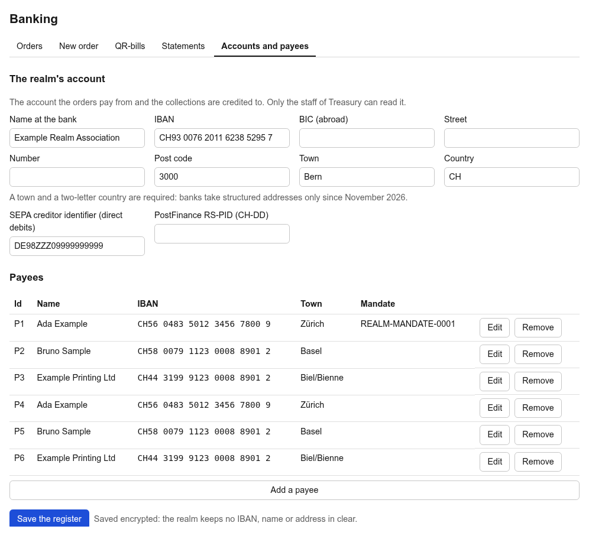
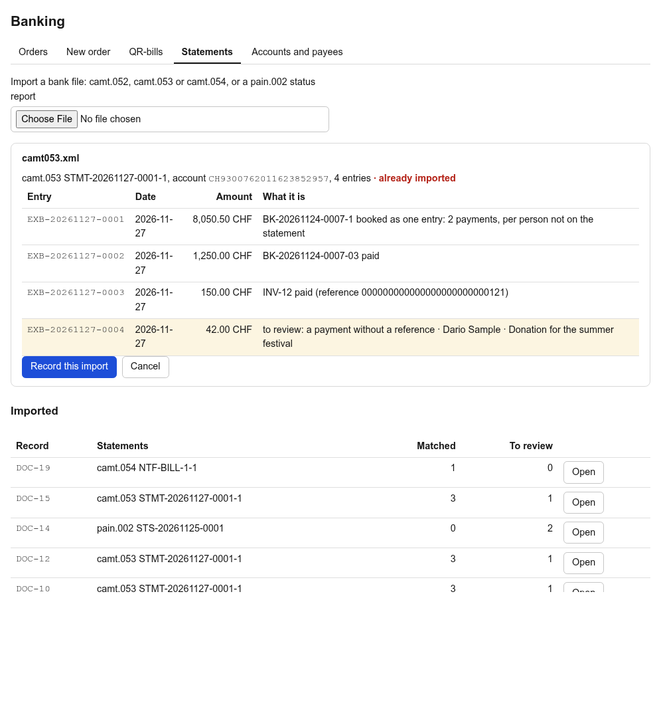
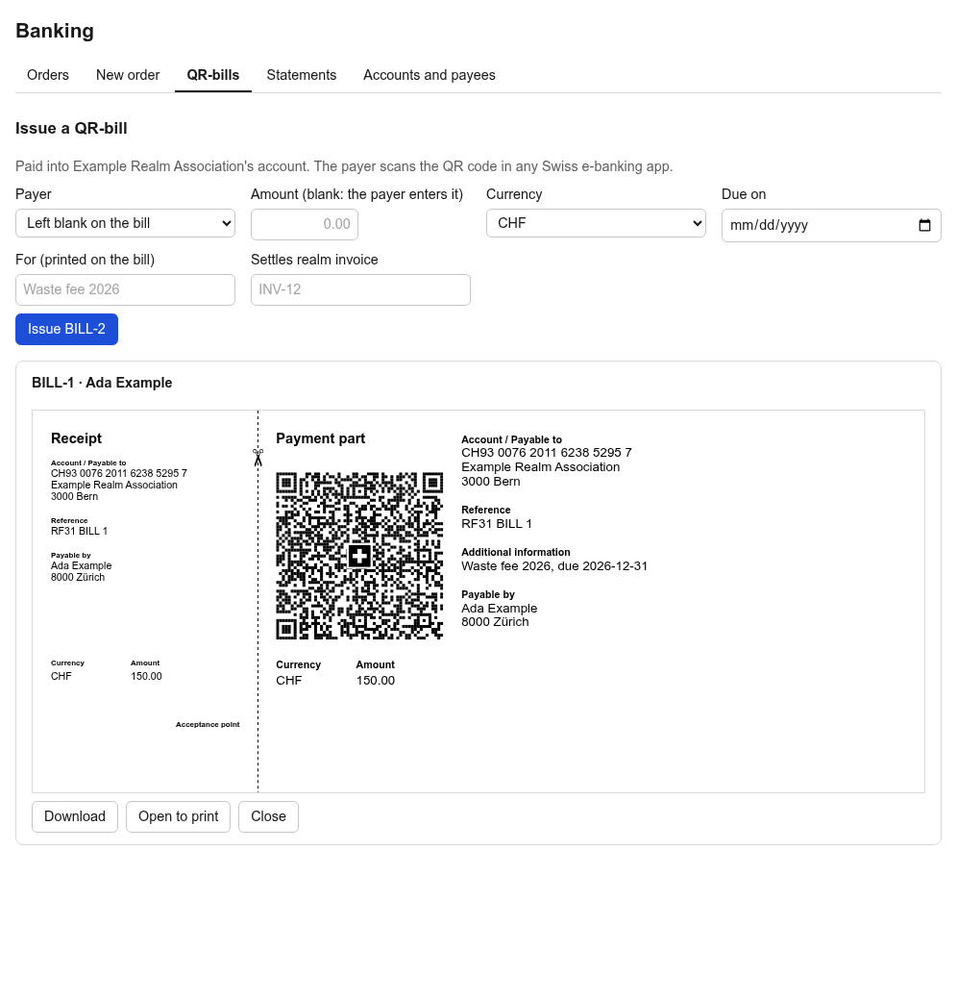
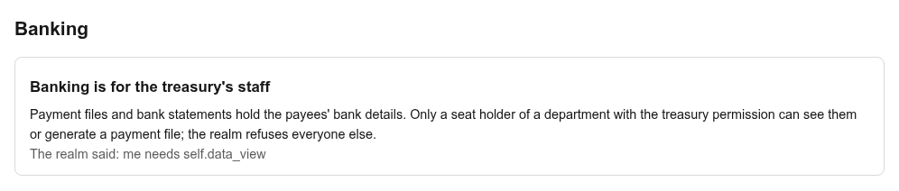

# Banking

Pay, collect and be paid through the realm's ordinary bank account. The realm writes the bank file, the treasurer
uploads and signs it in the realm's own e-banking, and the bank's reports come back to be matched. Nothing here talks
to a bank, and the bank details stay encrypted: only the treasury's staff can read them.

> **Status: prototype.** Draft pull requests #121 (this extension) to #124. Every file it writes and reads is tested
> against the official SIX and ISO schemas, on a local realm. It has never been tried with a real bank.

## What a treasurer does

**1. Keep the bank register.** The realm's own account and each payee's IBAN, name and address, saved encrypted for the
treasury's staff.

**2. Pay, or collect by direct debit.** Choose payees and amounts. *Commit and download* records the file's fingerprint
(sha256) and every amount in the realm before the treasurer gets the file, so the realm always knows exactly what was
sent to the bank.

**3. Check before signing.** The second signatory opens the order and compares each line, read from the file itself,
with the e-banking screen before signing there. Some banks book a salary run as one line on the statement, so this
list is the only place the individual payments can be checked.

**4. Bring the bank's files back.** A status report marks the order accepted or rejected. A statement matches payments,
collections, returned payments and paid invoices; anything else goes on a review list.

**Bill residents and companies.** A Swiss QR-bill for a tax, a fee or an invoice, in CHF or EUR, paid by scanning the
code in any e-banking app. Its reference names the bill, so the statement import marks it paid.

**5. Follow every order** from the file to the bank's acceptance to the booking.

Anyone else is refused, by the realm as well as the screen.

## What is supported, and why

| | Supported | Why, or why not |
|---|---|---|
| **Payments** | Swiss Payment Standards 2025 (pain.001.001.09.ch.03): domestic, QR-bill, SEPA, foreign currency, salaries. SEPA credit transfer (pain.001.001.09). | What Swiss and euro-area banks take today. |
| | Not: CGI-MP, NACHA, Bacs, other national formats. | Not needed for Swiss or EU public bodies; each would be one more writer. |
| **Direct debits** | SEPA Direct Debit Core (pain.008.001.08). PostFinance CH-DD. | The two open to a new creditor. |
| | Not: LSV+ / BDD, eBill Direct Debit. | LSV+ / BDD take no new creditors since 1 January 2026 and end in September 2028. eBill runs through its own network, not a file. |
| **Bank reports** | Status reports (pain.002). Statements and notifications (camt.052, camt.053, camt.054). | What Swiss and EU banks deliver. |
| | Not: MT940. | Swiss banks deliver camt. |
| **Bank connection** | File upload and download in the realm's e-banking. | Works with any bank, no contract, and the bank keys stay with the people who sign. |
| | Not: EBICS, SIX bLink. | Each needs a bank or SIX contract and a program outside the realm; a later step. |
| | Never: the realm calling the bank itself. | A blockchain call is repeated by every node, and the realm cannot keep a bank key secret. |
| **Bills** | Swiss QR-bills to residents and companies, marked paid by their reference (in review, #124). | The way residents and companies already pay Swiss public bodies. The QR code is drawn by the `swissqrbill` library, which the realm trusts to encode the IBAN it is given: see [DESIGN.md](DESIGN.md). |
| **ERPs** | Approve a payment file made by the public body's ERP: in review (#123). ERPNext connector: in review (#122). Odoo connector: in progress. | The ERP keeps the books; the realm approves what it pays. |
| **Not yet** | Members entering their own bank details. Billing the realm's own invoices in francs. Paying a realm transfer through the bank. | Each needs a change to the realm itself, written up in [GGG-PROPOSAL.md](GGG-PROPOSAL.md). |

## Limits

- **Never tried with a real bank.** The files pass the official schemas; each bank still has its own rules, so a bank's
  test portal comes before the first real payment.
- **Runs in the realm's page.** A sandboxed screen would be safer, but today a sandbox can neither decrypt bank details
  nor hand over a file. The way to sandbox it is in [DESIGN.md](DESIGN.md).
- **English only.**

How it works, what the realm stores in clear and what it keeps encrypted, the matching rules, and the tests:
[DESIGN.md](DESIGN.md).
