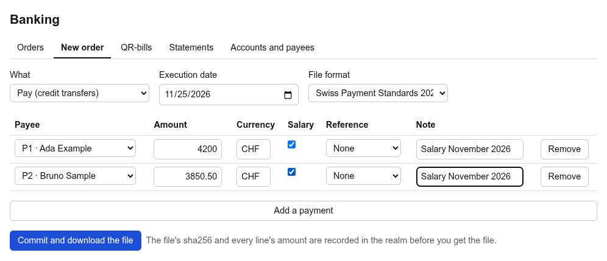
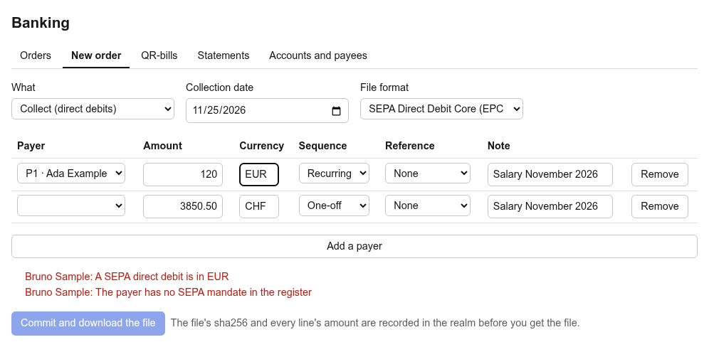
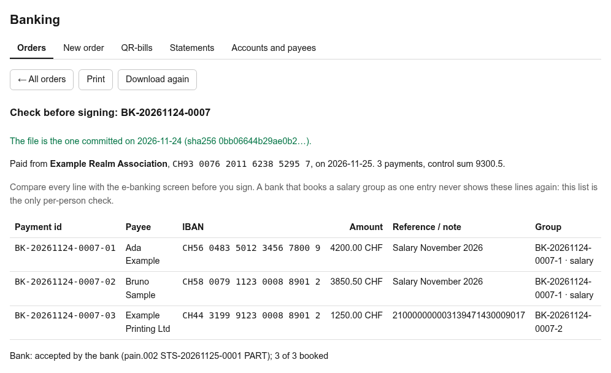
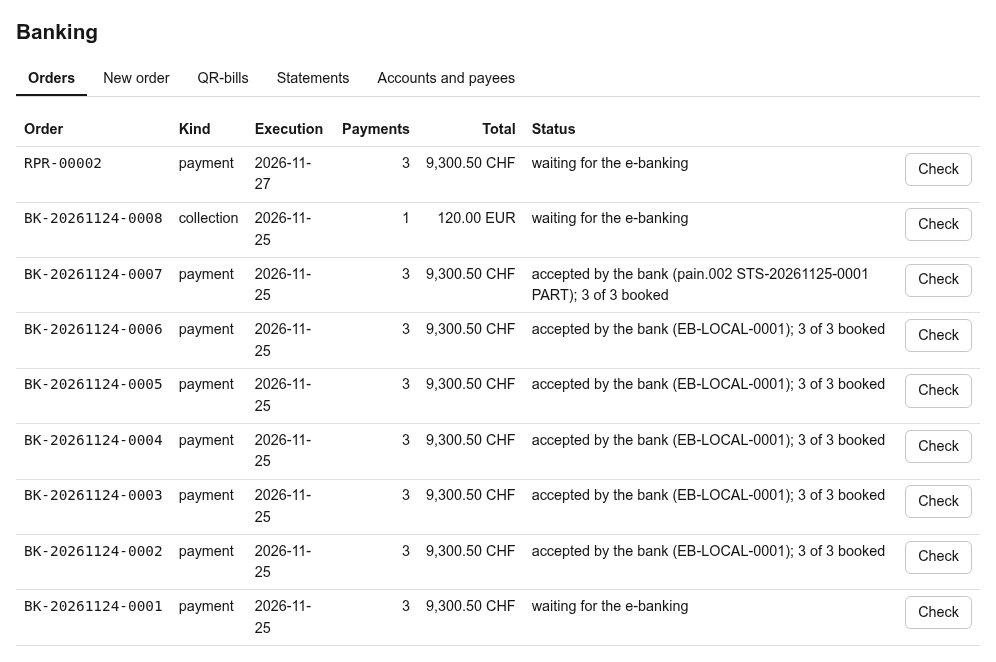
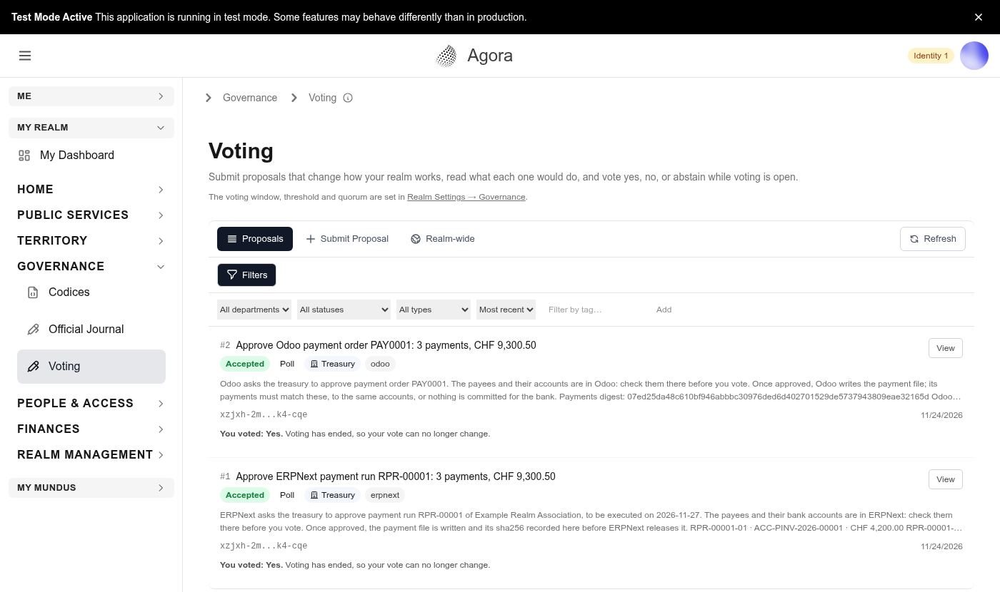
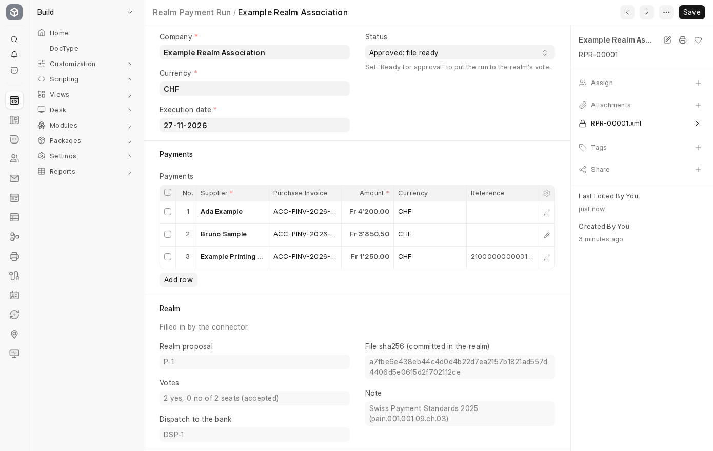

# Banking

Pay, collect and be paid through the realm's ordinary bank account. The realm writes the bank file, the treasurer
uploads and signs it in the realm's own e-banking, and the bank's reports come back to be matched. Nothing here talks
to a bank, and the bank details stay encrypted: only the treasury's staff can read them.

> **Status: prototype.** Draft pull requests #121 (this extension) to #124. Every file it writes and reads is tested
> against the official SIX and ISO schemas, on a local realm. It has never been tried with a real bank.

## What a treasurer does

**1. Keep the bank register.** The realm's own account and each payee's IBAN, name and address, saved encrypted for the
treasury's staff.


**2. Pay, or collect by direct debit.** Choose payees and amounts. *Commit and download* records the file's fingerprint
(sha256) and every amount in the realm before the treasurer gets the file, so the realm always knows exactly what was
sent to the bank.




**3. Check before signing.** The second signatory opens the order and compares each line, read from the file itself,
with the e-banking screen before signing there. Some banks book a salary run as one line on the statement, so this
list is the only place the individual payments can be checked.



**4. Bring the bank's files back.** A status report marks the order accepted or rejected. A statement matches payments,
collections, returned payments and paid invoices; anything else goes on a review list.


**5. Follow every order** from the file to the bank's acceptance to the booking.



Anyone else is refused, by the realm as well as the screen.


## With the public body's ERP

A public body that keeps its books in an ERP keeps them there. The realm's treasury votes on each payment run, and the
realm records the exact file that goes to the bank. Connectors for ERPNext and Odoo run the whole loop; any other ERP
can upload its pain.001 in the Banking screen instead.

**1. The ERP asks.** A payment run in ERPNext, or a payment order in Odoo, becomes a motion in the treasury
department: ids and amounts only, never a name or an account.



**2. The treasury votes** in the realm, under its own policy (here 2 of 2).

**3. The ERP carries on.** Approved, the ERPNext connector writes the file and attaches it, after recording its sha256
in the realm. In Odoo the realm's vote is the review the order waits for. Odoo writes the file, and the connector
checks that it pays exactly what was approved before recording its hash.




How each connector works: [connectors/](connectors/README.md).

## Try it on your machine

One command starts a local realm with Banking and a treasury with two seats, plus ERPNext and Odoo, each with example
suppliers and a payment run to approve, and the two connectors between them.

```bash
git clone --recurse-submodules https://github.com/smart-social-contracts/realms-gos.git
pip install -e realms-gos/cli        # and the realm build environment: realms-gos/AGENTS.md
git clone https://github.com/smart-social-contracts/realms-extensions.git

REALMS_GOS=$PWD/realms-gos realms-extensions/extensions/banking/demo/up.sh
```

It needs Docker, Node 22+, Python 3 and about 15 GB of disk. The first run takes 30–60 minutes, mostly downloads and
building the realm. When it finishes it prints the addresses:

| | Address | Sign in |
|---|---|---|
| Realm | `http://<realm>.localhost:8000/join?ti=0&test_mode=1&skip_ii=1` | *Continue as Identity 1*; Identity 2 with `ti=1`, in a private window |
| ERPNext | http://127.0.0.1:8080/app/realm-payment-run/RPR-00001 | `Administrator` / `admin` |
| Odoo | http://127.0.0.1:8069/odoo/account.payment.order/1 | `admin` / `admin` |

To try it:
1. In ERPNext, set the run's *Status* to *Ready for approval* and save. In Odoo, press *Request Validation*.
2. In the realm, under *Voting*, vote yes on both motions as Identity 1, then as Identity 2.
3. ERPNext shows *Approved: file ready*, with the file attached. In Odoo, press *Confirm Payments*, then *Generate
   Payment File*; its *Realm* tab then shows the file's hash committed in the realm.

`demo/up.sh realm|erpnext|odoo|connectors` starts one part; `demo/down.sh` stops everything (`--wipe` also deletes the
ERPs' data). Ports and the state folder are set by `REALM_PORT`, `ERPNEXT_PORT`, `ODOO_PORT` and `DEMO_HOME`;
`BUILD_PYTHON` names the Python that builds the realm, if it is not `python3`.
Everything is local and made up: example IBANs, invented suppliers, demo passwords.

## What is supported, and why

| | Supported | Why, or why not |
|---|---|---|
| **Payments** | Swiss Payment Standards 2025 (pain.001.001.09.ch.03): domestic, QR-bill, SEPA, foreign currency, salaries. SEPA credit transfer (pain.001.001.09). | What Swiss and euro-area banks take today. |
| | Not: CGI-MP, NACHA, Bacs, other national formats. | Not needed for Swiss or EU public bodies; each would be one more writer. |
| **Direct debits** | SEPA Direct Debit Core (pain.008.001.08). PostFinance CH-DD. | The two open to a new creditor. |
| | Not: LSV+ / BDD, eBill Direct Debit. | LSV+ / BDD take no new creditors since 1 January 2026 and end in September 2028. eBill runs through its own network, not a file. |
| **Bank reports** | Status reports (pain.002). Statements and notifications (camt.052, camt.053, camt.054). | What Swiss and EU banks deliver. |
| | Not: MT940. | Swiss banks deliver camt. |
| **Bank connection** | File upload and download in the realm's e-banking. | Works with any bank, no contract, and the bank keys stay with the people who sign. |
| | Not: EBICS, SIX bLink. | Each needs a bank or SIX contract and a program outside the realm; a later step. |
| | Never: the realm calling the bank itself. | A blockchain call is repeated by every node, and the realm cannot keep a bank key secret. |
| **Bills** | Swiss QR-bills to residents and companies, marked paid by their reference: in review (#124). | |
| **ERPs** | Approve a payment file made by the public body's ERP: in review (#123). ERPNext and Odoo connectors (in review, #122 and #125): see [connectors/](connectors/README.md). | The ERP keeps the books; the realm approves what it pays. |
| **Not yet** | Members entering their own bank details. Billing the realm's own invoices in francs. Paying a realm transfer through the bank. | Each needs a change to the realm itself, written up in [GGG-PROPOSAL.md](GGG-PROPOSAL.md). |

## Limits

- **Never tried with a real bank.** The files pass the official schemas; each bank still has its own rules, so a bank's
  test portal comes before the first real payment.
- **Runs in the realm's page.** A sandboxed screen would be safer, but today a sandbox can neither decrypt bank details
  nor hand over a file. The way to sandbox it is in [DESIGN.md](DESIGN.md).
- **English only.**

How it works, what the realm stores in clear and what it keeps encrypted, the matching rules, and the tests:
[DESIGN.md](DESIGN.md).
