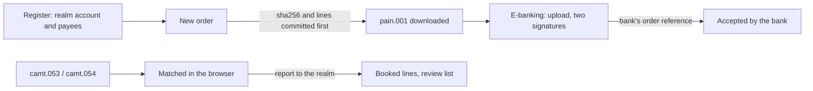

# Banking extension

Pay and be paid through the realm's ordinary bank account, with no bank connector. The realm writes the payment
file, the treasurer uploads and approves it in the realm's own e-banking, and brings the bank's statements back.
No bLink, no EBICS, no operator service: nothing here talks to a bank.

1. **Register.** The realm's own account and each payee's bank details (IBAN, name at the bank, postal address),
   kept as one encrypted record of the treasury department.
2. **Order.** The treasurer picks payees and amounts. The file is generated in the browser, deterministically, and
   its sha256 and every line (id, amount, currency, payment group, payee id) are recorded in the realm **before** the
   file is handed out. Each payment's `EndToEndId` is its realm id (`BK-20261124-0001-03`).
3. **Check before signing.** The second signatory opens the order and compares the per-person list, read from the
   committed file itself, with the e-banking screen. At a bank that books a salary group as one entry this list is
   the only per-person check: PostFinance's EPO manual (Sep 2024, §4.2.9) says salary orders ignore `BtchBookg` and
   are always batch-booked, so the per-person lines never reach `camt.053`.
4. **Accepted.** Once signed in the e-banking, the bank's order reference is recorded as the dispatch's receipt.
5. **Statements.** A `camt.053` or `camt.054` is read and matched in the browser: outgoing payments by `EndToEndId`
   (or by their payment group when the bank books the group as one entry), returns by `EndToEndId`, incoming payments
   by the invoice's QR or RF reference. The file is kept encrypted with its matches, each statement is reported to the
   realm, and whatever did not match is listed for review.

## What the realm keeps, and who sees it

Nothing in the realm changes for this extension: it uses GGG's Document, External and Dispatch as they are.

| Record | How | In clear | Encrypted |
|---|---|---|---|
| Bank register | Document `banking.register` of the treasury department | title only | accounts, payees |
| Payment order | Document `banking.order`; a dispatch to the outside body `bank` (channel `manual`) | sha256, per line: id, amount, currency, group, payee id | the file |
| Statement import | Document `banking.statement`; `external_report` per statement | ids, amounts, dates, counts | the file, the matches with names |

**Per-person amounts stay in clear**, as transfers are today; bank details and the statement files do not. The keys
are the realm's live scheme (vetKD, a per-record key wrapped per principal: realms-gos `lib/crypto/sharing.ts`), wrapped
for the department's head and seat holders at the time of saving. Someone seated later reads a record once a colleague
saves it again.

**Permission.** The treasury department is the one where the user holds a seat and the treasury permission. The realm
enforces the rest: `document_store`, `document_list` and the document's key are for that department's staff only
(realms-gos `api/crypto.py`, `staff()`), whatever other permission a caller holds. Sending the order to the bank's
outbox, confirming it and reporting a statement also need `notification.send`, `dispatch.confirm` and `external.report`,
which the realm's codex must give the treasury's seats.

## Formats

The format layer is `frontend-rt/src/lib/formats.ts`: each format is its checks, its grouping and its writer, so a new
one (generic ISO 20022 CGI-MP, a national fixed-width format) is one more entry.

- **Swiss Payment Standards 2025**: `pain.001.001.09`, SIX's XSD `pain.001.001.09.ch.03.xsd`, IG v2.2. Payment types
  D (domestic CHF/EUR, QR-bill with a QR-IBAN and QR reference), S (SEPA) and X (foreign currency, abroad: needs the
  payee bank's BIC); one payment group per type, currency and salary flag; salaries carry `CtgyPurp/Cd SALA` at the
  group level; `BtchBookg` true; the debtor bank by its IID when no BIC is given; the software in `InitgPty/CtctDtls`
  (IG 3.9); the SPS character set (IG 3.1) checked, not converted.
- **SEPA Credit Transfer** (EPC132-08, 2025 v1.0): `pain.001.001.09`. The EPC's own XSD could not be downloaded by a
  script (the EPC site sits behind a bot check), so the file is validated against ISO's `pain.001.001.09.xsd` and the
  EPC rules are enforced in code (`lib/sepa.ts`). That is a weaker guarantee: a reviewer cannot re-run a schema to
  check them. The rules implemented: EUR only; debtor and payee IBANs in SEPA countries; amount at most 999,999,999.99;
  service level `SEPA` and charges `SLEV` on every group; a creditor reference or a note, not both; no QR reference;
  names, towns and notes converted to the EPC's basic Latin set (accents dropped, `&` as `+`), and shown converted on
  the review screen; `NOTPROVIDED` as the debtor bank when no BIC is given.
- **Statements**: `camt.053` and `camt.054`, read by element name, so versions 001.04 to 001.08 work.

## Running in the page, and what a sandbox would need

The screen runs in the realm's page, like vault and department_docs. A sandboxed frame has no `ctx.crypto`, and
bundling vetKeys into the frame would hand it the user's whole vetKey, which opens everything ever wrapped for them;
the frame also may not start a download (`allow-downloads` is not in the iframe's sandbox). All decryption therefore goes
through one interface, `lib/vault.ts`, and the download through `saveFile` in `env.ts`. Sandboxing the extension means
the host offers these as capabilities and the extension swaps those two:

- `vault.seal(recipients, data)` → host: seal for these principals;
- `vault.open(wrappedKey, ciphertext)` → host: open this document for me (the key never enters the frame);
- `saveFile(name, text)` → host: commit-then-save these bytes. The host would then enforce "the hash is recorded
  before the file leaves" itself.

The same host capability is a prerequisite for members entering their own bank details from member_dashboard, which
is sandboxed already.

## Tests

- `run_tests.sh`: the unit tests (`frontend-rt/src/lib/*.test.ts`: formats, references, camt matching, the encryption
  round trip and permission refusal on an in-memory realm), the build, and `tests/xsd/check.sh`, which validates the
  sample files against the pinned SIX and ISO schemas. The check uses the JDK's validator: libxml2 (`xmllint`) cannot
  compile the SPS schema, whose character-set pattern subtracts a class (`[...-[\p{C}]]`).
- `tests/e2e/walk.py`: the whole flow on a local test-mode realm with the real vetKD, as the treasurer, the second
  signatory and a non-member, and a non-staff call the realm refuses.

Every IBAN in the samples and fixtures is a published documentation example, and every name is made up.

## Not done in this version

- Payees are entered by the treasury, not by the members themselves: the realm has no encrypted payout account a
  member can share with the treasury yet (see the GGG proposal in the pull request).
- No pain.002 status report import; the bank's acceptance is entered by hand.
- One register record: two treasurers saving at once keep the last save.
- English only.
