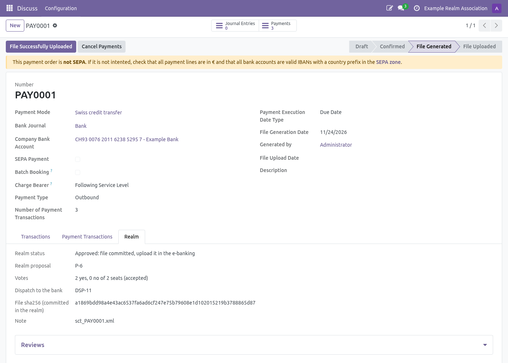

# Odoo connector (demo)

The realm's treasury approves Odoo's payment orders, and records the exact file Odoo writes before it goes to the bank.
Odoo 18 Community with the OCA modules: payment orders (`account_payment_order`), Swiss Payment Standards files
(`l10n_ch_pain_credit_transfer`, pain.001.001.09.ch.03) and tier validation (`account_payment_order_tier_validation`).

1. A treasurer makes a payment order in Odoo from the bills to pay, and asks for validation. OCA keeps the order in
   draft until its review is approved, and the connector's Odoo user is the reviewer.
2. The connector files a **motion** in the realm's treasury department: the payments by Odoo id and amount, and a
   digest that binds the accounts they go to without showing them.
3. The department's seats **vote** in the realm. Approved: the connector approves the review in Odoo, and the treasurer
   confirms the order and generates its file there. Rejected: the connector rejects the review, and the order cannot
   be confirmed.
4. Once Odoo has written the file, the connector reads it back. If it pays exactly the approved amounts to the approved
   accounts, the connector **records its sha256 in the realm** as a dispatch to the bank naming the motion; otherwise
   it marks the order *Problem* and commits nothing.



Unlike the ERPNext connector, which writes the file itself, here Odoo writes it, and the realm vouches that it holds
what the treasury approved.

## Running it

Needs Odoo 18 with the three OCA repositories `bank-payment`, `l10n-switzerland` and `server-ux` on its addons path,
a database with `l10n_ch`, `account_payment_order`, `account_banking_sepa_credit_transfer`,
`l10n_ch_pain_credit_transfer` and `account_payment_order_tier_validation` installed. `odoo-setup.py`, run in an Odoo
shell, prepares an empty database for the demo: the Swiss company, bank account and payment mode, the connector's
user (`realm-connector`), the tier definition naming it reviewer, the *Realm* page on payment orders, and three
suppliers with example IBANs, their bills and a draft payment order. The realm side is as for ERPNext.

```
# .env: ODOO_URL, ODOO_DB, ODOO_LOGIN, ODOO_PASSWORD, and the REALM_* settings
npm start -- odoo
```

Two details of OCA's tier validation it relies on:
- the connector writes its own fields with the `skip_validation_check` context, since the order is locked while under
  review; a `tier.validation.exception` would instead lock every other field after validation, and Odoo could no longer
  record the file it generates;
- a review requested in Odoo shows as `pending` (or `waiting`, behind another tier).

## What it is not (yet)

- A demo: a polling process with the connector's Odoo password, not an Odoo module.
- The motion binds the amount to each account (summed, since OCA may merge several bills to one supplier), not each
  bill: two bills to the same supplier may swap amounts and still match.
