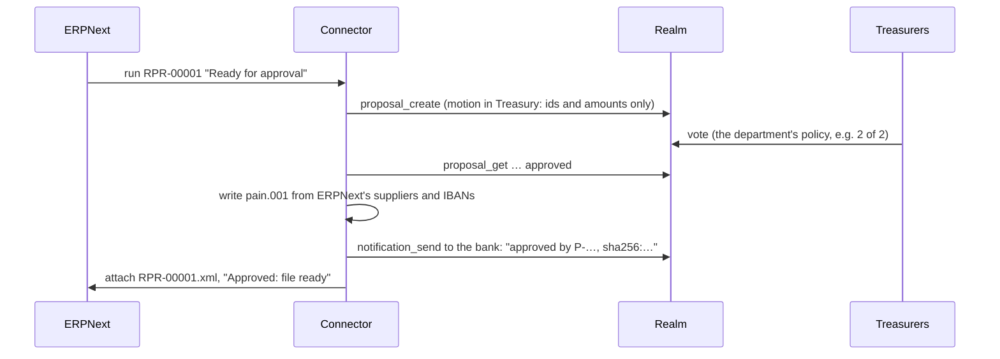

# ERPNext connector (demo)

Realms as the governance layer over an ERP: ERPNext keeps the books, the suppliers and their bank accounts; the realm
decides whether a payment run may be paid, and records the exact file that leaves.



1. In ERPNext a treasurer makes a **Realm Payment Run** (company, execution date, one line per supplier invoice) and
   sets its status to *Ready for approval*.
2. The connector files a **motion** in the realm's treasury department. It names the run's payments by ERPNext id and
   amount only; the names and IBANs stay in ERPNext. The run shows *Awaiting the realm*, the proposal and the votes.
3. The department's seats **vote** in the realm, under its own policy (m of n).
4. Approved: the connector writes the payment file (Swiss Payment Standards, or SEPA outside Switzerland: the Banking
   extension's tested writers), **records its sha256 in the realm** as a dispatch to the bank naming the motion, and only
   then attaches the file to the run: *Approved: file ready*. Rejected, withdrawn or expired: *Rejected by the realm*,
   and no file is ever written.

The realm needs no change: the approval is an ordinary department motion, and the commitment an ordinary dispatch to
the outside body `bank` (Realms GOS reaches outside bodies only through such dispatches, `api/external.py`, I-EXT-6).

## Running it

Needs a realm with a treasury department whose seats vote on payment runs, an outside body `bank`, and the connector
as a member holding `notification.send` (its key is made on first use); and an ERPNext site with the two doctypes and
an API key, which `npm run setup-erpnext` creates on an empty site, with demo data (example IBANs only).

```
npm install
# .env: ERPNEXT_URL, and an API key and secret (ERPNext: User → API Access → Generate Keys) as ERPNEXT_KEY, ERPNEXT_SECRET;
#       REALM_HOST, REALM_CANISTER, REALM_IDENTITY (a path outside the repository), REALM_TREASURY, POLL_SECONDS
npm run setup-erpnext   # on an empty site: the setup wizard, the two doctypes, demo suppliers and a draft run
npm start
```

`npm test` runs the steps on an in-memory ERPNext and realm.

## A policy with no spare approver

The demo realm's Treasury approves 2 of 2, with both seats filled. That has no margin: in Realms GOS a department's own
policy governs its seating (`appoint`) and its policy (`department_set_policy`), so once fewer seat holders remain than
the policy needs, the department can no longer seat anyone or lower its threshold. agora's Economy department on the
same local realm is already stuck that way (2 of 3, no seat filled). A real treasury wants m below its seats, e.g. 2 of 3.

## What it is not (yet)

- A demo: one polling process with an API key, not a Frappe app. A real deployment would run as a Frappe app or a
  service the institution's IT operates, with the connector's key kept as a secret there.
- The ERPNext side has no lock of its own: a user who can write files there could still upload another one. What the
  realm adds is that the file the bank receives can be checked against the hash it approved.
- Statements are not brought back to ERPNext; the Banking extension matches them in the realm.
